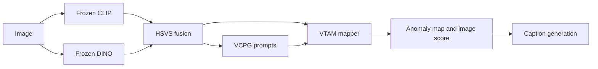

# Architecture

The detector uses frozen CLIP and DINO feature extractors, then trains fusion, prompt, and anomaly-map modules. This package implements the cable experiment trained on the MVTec AD 70/20/10 resplit. The base SSVP method is described in [arXiv 2601.09147](https://arxiv.org/abs/2601.09147).

## Package map

| Module | Responsibility |
| --- | --- |
| [backbones.py](../src/ssvp_rc/models/backbones.py) | Load frozen CLIP and DINO encoders and collect global and local tokens. |
| [hsvs.py](../src/ssvp_rc/models/hsvs.py) | Fuse CLIP and DINO tokens through attention at each scale. |
| [vcpg.py](../src/ssvp_rc/models/vcpg.py) | Generate normal and abnormal text prompts conditioned on fused visual features. |
| [vtam.py](../src/ssvp_rc/models/vtam.py) | Aggregate local anomaly maps and fuse local and global image scores. |
| [ssvp.py](../src/ssvp_rc/models/ssvp.py) | Connect backbones, fusion, prompts, map, and optional training branches. |
| [losses.py](../src/ssvp_rc/models/losses.py) | Segmentation, classification, VAE, and prompt regularization losses. |
| [mvtec.py](../src/ssvp_rc/data/mvtec.py) | Load MVTec category splits and masks. |
| [transforms.py](../src/ssvp_rc/data/transforms.py) | Apply image and mask transforms. |
| [utils.py](../src/ssvp_rc/utils.py) | Hold evaluation metrics, postprocessing, and visualization helpers. |
| [captioning.py](../src/ssvp_rc/captioning.py) | Build spatial and domain caption targets. |
| [paths.py](../src/ssvp_rc/paths.py) | Resolve the repository root by walking to `pyproject.toml`. |

## Feature flow

CLIP supplies semantic features and DINO supplies structural features. HSVS applies an adaptive token fusion block to their global and local outputs. VCPG uses the fused global feature to form normal and abnormal prompt embeddings. VTAM compares those prompts with local visual features, gates the per-scale maps, and combines the local evidence with a global score. [ssvp.py](../src/ssvp_rc/models/ssvp.py) exposes the connected model.

The default backbone input is 518 pixels. Its patch grid is 37 by 37, so the local path has 1,369 tokens per image at that setting. [default.yaml](../configs/default.yaml) owns the configured dimensions and training switches. The small CPU tests in [test_shapes.py](../tests/test_shapes.py) check interfaces with dummy tensors; they do not load backbone weights.

## Losses and evaluation

The training path combines focal and Dice segmentation loss, image classification loss, VAE reconstruction and KL terms, and prompt margin regularization. Configuration controls optional denoising, consistency, PRO-oriented, and distillation terms. The source math remains in [losses.py](../src/ssvp_rc/models/losses.py) and the training loop remains in [train.py](../scripts/pipelines/train.py).

Clean and noisy evaluation call the same metric helpers in [utils.py](../src/ssvp_rc/utils.py). The noisy wrapper changes the input images through the configured heavy noise protocol; it does not change metric definitions. Caption evaluation reads the segmentation output and compares generated text with spatial or domain references. Deterministic spatial synthesis can match a reference designed with the same phrasing, as described in [experiments.md](experiments.md).

## Runtime boundaries

The package installer exposes `ssvp_rc`. Scripts import it directly and obtain repository paths from [paths.py](../src/ssvp_rc/paths.py). User data belongs under `data/mvtec/`, which the data preparation command creates at runtime. Scripts write new artifacts beneath `outputs/`, also created at runtime. The committed [results tables](../results/tables/metrics.md) transcribe existing experiments and need neither directory.

WinCLIP and AnomalyCLIP source live under [third_party](../third_party/). The WinCLIP wrapper uses the merged resize, dataset, and AP patches described in [THIRD_PARTY.md](../THIRD_PARTY.md). No baseline weights or datasets are committed.
